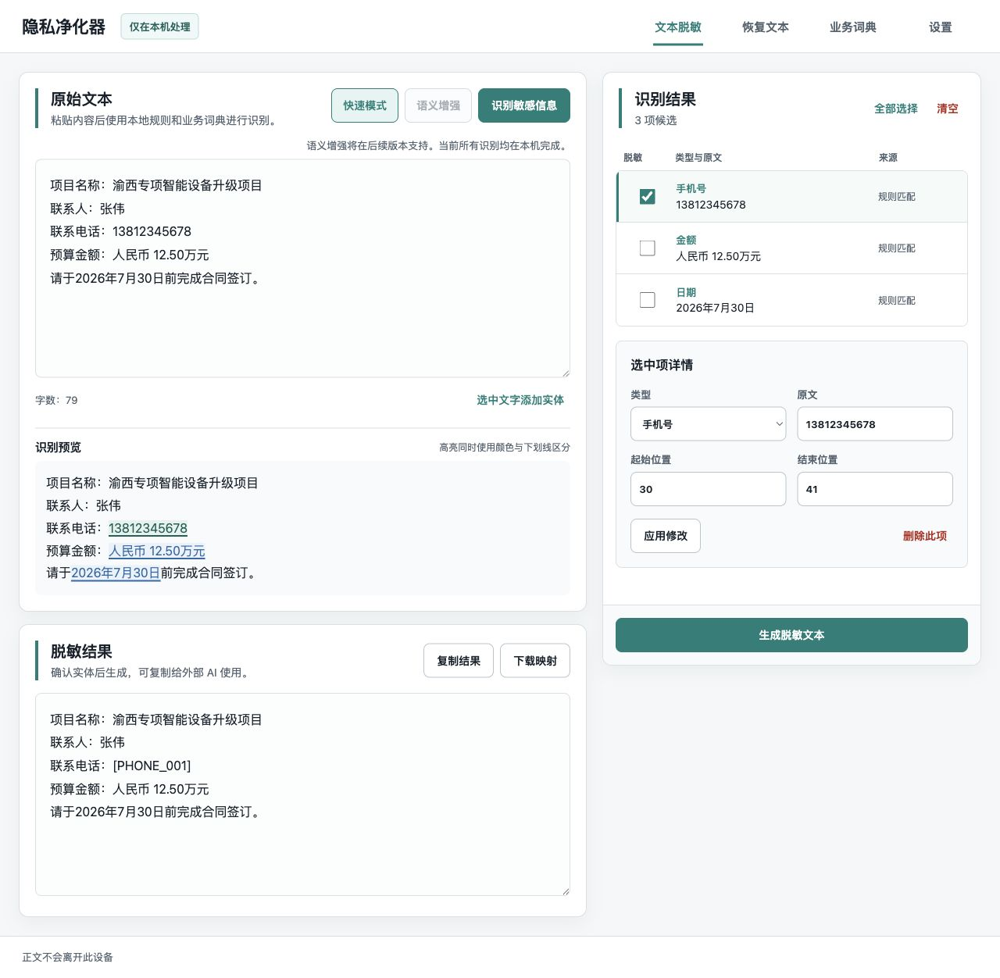

# PrivacyLLM

[](https://github.com/SkyBridgeM/PrivacyLLM/actions/workflows/tests.yml)
[](LICENSE)
[](https://www.python.org/)

PrivacyLLM 是一款本地运行的可逆文本脱敏工具。它可以在你把内容发送给 ChatGPT、Claude 或其他外部 AI 之前，将人名、联系方式、机构、项目名称和业务秘密替换为稳定占位符；外部 AI 返回结果后，再用当前会话映射恢复原文。

整个脱敏、映射和恢复流程均在本机完成。



## 主要功能

- 识别手机号、邮箱、身份证、银行卡、信用代码、金额、日期和 IP 地址等格式化信息。
- 使用本地业务词典和自定义正则规则识别专有内容。
- 可选连接本机 Ollama，通过 `qwen3.5:4b` 增强人名、机构、部门、项目和业务秘密识别。
- 在生成结果后直接选中漏识别的文字，补充为自定义脱敏。
- 逐项启用、取消、编辑或删除识别结果，并处理重叠冲突。
- 使用 `[PERSON_001]`、`[PHONE_001]` 等稳定占位符，便于外部 AI 保持上下文。
- 当前页面自动使用本次脱敏映射恢复 AI 返回内容，也可导入其他映射文件。
- 本地管理业务词典和默认脱敏策略。

## 快速开始

### 1. 安装项目

需要 Python 3.11 或更高版本，以及 [uv](https://docs.astral.sh/uv/)。

```bash
git clone https://github.com/SkyBridgeM/PrivacyLLM.git
cd PrivacyLLM
uv sync --extra dev
```

### 2. 启动 PrivacyLLM

```bash
uv run python scripts/run_local.py
```

浏览器会自动打开：

```text
http://127.0.0.1:8765
```

应用只监听本机回环地址，不会向局域网公开 WebUI。

## 启用语义增强

语义增强是可选功能。先安装 [Ollama](https://ollama.com/)，然后下载模型：

```bash
ollama pull qwen3.5:4b
```

确保 Ollama 正在运行，再启动 PrivacyLLM。页面检测到模型后会自动启用“语义增强”选项。

默认配置：

```text
Ollama 地址：http://127.0.0.1:11434
模型：qwen3.5:4b
```

可以通过环境变量覆盖：

```bash
PRIVACYLLM_OLLAMA_URL=http://127.0.0.1:11434 \
PRIVACYLLM_OLLAMA_MODEL=qwen3.5:4b \
uv run python scripts/run_local.py
```

如果 Ollama 不可用，快速模式仍可正常使用。

## 使用流程

1. 将原始文本粘贴到“文本脱敏”页面。
2. 选择快速模式或语义增强，点击“识别敏感信息”。
3. 在识别预览中复核候选项；点击下划线可切换是否参与脱敏。
4. 点击“生成脱敏文本”，复制结果并发送给外部 AI。
5. 如果结果中仍有漏出的敏感文字，直接选中它并点击“标记为自定义脱敏”。
6. 将外部 AI 返回的文本粘贴到“恢复文本”页面。当前页面会默认使用本次脱敏生成的映射。

## 本地配置

默认配置文件：

- `config/dictionary.json`：业务词典；
- `config/custom_regex_rules.json`：自定义正则规则；
- `config/settings.json`：默认脱敏策略。

配置保存时会先校验结构，再原子替换原文件，并保留 `.bak` 备份。备份文件已被 Git 忽略。

## 隐私与安全

- WebUI 不使用 CDN、外部字体、遥测或第三方前端资源。
- 快速模式不会把正文发送给外部服务。
- 语义增强只把正文发送给配置的 Ollama 地址；如果你将地址改为远程服务器，正文也会随之发送到该服务器。
- 映射导出目前是明文 JSON，包含恢复原文所需信息，请勿上传到公共仓库或发送给外部服务。
- 自动识别无法保证覆盖所有敏感信息，发送前仍需人工复核。

安全问题请参阅 [SECURITY.md](SECURITY.md)，报告时不要包含真实个人数据或机密文件。

## 开发与测试

```bash
uv run --extra dev python -m pytest
```

当前测试覆盖规则识别、业务词典、自定义正则、实体合并、占位符生成、映射恢复、设置存储和 API 流程。

## 技术栈

- Python、FastAPI、Pydantic
- 原生 HTML、CSS、JavaScript
- Ollama（可选）
- Qwen 3.5 4B（可选）

## 许可证

本项目使用 [MIT License](LICENSE)。
